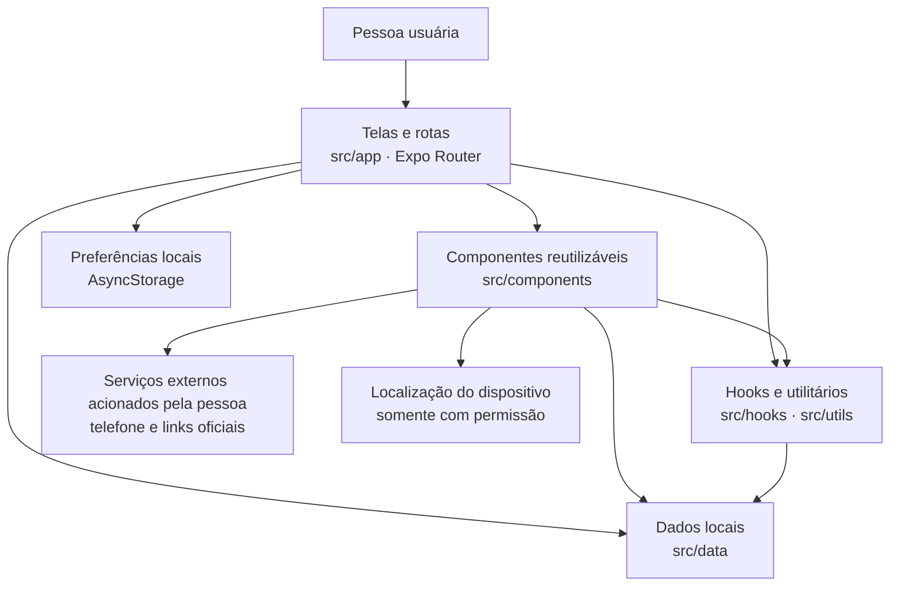
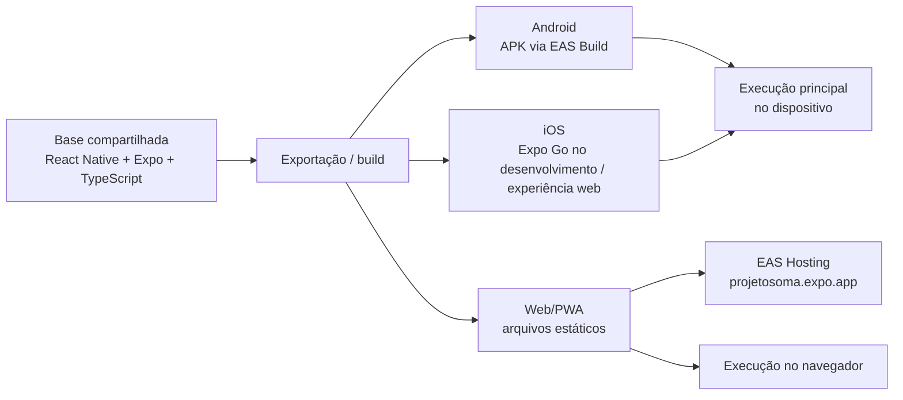
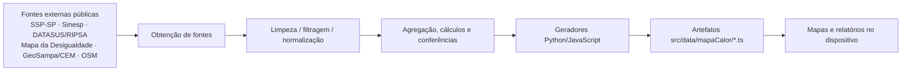

# Projeto SOMA — Documento de Arquitetura de Software

**Sistema:** SOMA — Segurança, Orientação, Monitoramento e Apoio\
**Natureza:** MVP acadêmico de orientação e acesso à rede de proteção\
**Repositório de referência:** [StenioCalado/projeto-soma](https://github.com/StenioCalado/projeto-soma)\
**Baseline analisada:** `main`, commit [`f243aeda3184a047d359e318bc0f80ee04fc7e9a`](https://github.com/StenioCalado/projeto-soma/tree/f243aeda3184a047d359e318bc0f80ee04fc7e9a) — merge do PR #3 em **08/11/2026**\
**Estado deste documento:** análise arquitetural descritiva, proposta para revisão pelo grupo e pelo docente\
**Data da análise:** 08/11/2026

> **Escopo da evidência:** a estrutura e as decisões descritas se baseiam no código versionado, no `README.md`, em `scripts/mapa-calor/README.md` e nos relatórios em `docs/`. O documento distingue funcionalidades identificadas no código de testes de execução relatados por outros integrantes. Não representa auditoria de segurança, avaliação clínica/jurídica nem certificação de funcionamento em produção. A versão do fork `akaThigas/projeto-soma` não é a baseline deste documento.

## 1. Contexto, propósito e limites

O SOMA é um aplicativo multiplataforma voltado à orientação de mulheres em situação de violência doméstica. O produto organiza conteúdos educativos, acesso a canais oficiais de atendimento e emergência, informações da rede de apoio e visualizações territoriais de estatísticas públicas agregadas do estado de São Paulo.

O SOMA **não** constitui canal oficial de denúncia, não recolhe ou encaminha relatos à polícia, não despacha equipes de emergência, não oferece atendimento humano em tempo real e não substitui os serviços públicos competentes. Chamadas telefônicas e links externos transferem a ação ao telefone, navegador ou serviço de destino; não constituem integração institucional de protocolo.

O objetivo arquitetural é oferecer informações de forma compreensível e responsiva, reduzindo o tratamento de dados sensíveis e a complexidade operacional de um MVP acadêmico.

### 1.1 Escopo funcional comprovado no código

| Domínio funcional | Realização na baseline | Evidências no repositório |
| --- | --- | --- |
| Orientação | Telas de tipos de violência, conteúdos educativos e exploração | `src/app/tipos-violencia.tsx`, `src/app/explorar.tsx`, `src/data/conteudos.ts` |
| Canais de ajuda | Acesso orientado a serviços e números oficiais, como 180 e 190 | `src/app/denunciar.tsx`, `src/app/emergencia.tsx` |
| Rede de apoio | Listagem e busca de serviços, links, telefones e acesso ao mapa | `src/app/rede-apoio.tsx`, `src/data/mapaCalor/servicosMulherSP.ts` |
| Cartografia | Mapas interativos e relatórios estatísticos territoriais | `src/app/mapa.tsx`, `src/components/MapaInterativo.tsx`, `src/components/PainelDelegacias.tsx` |
| Navegação | Barra inferior global, retorno contextual e deep links | `src/app/_layout.tsx`, `src/components/BottomNavigation.tsx`, `src/components/PageNavigation.tsx` |
| Inclusão e discrição | Escala global de texto, áreas seguras e saída rápida | `src/components/AppText.tsx`, `src/components/AppSafeArea*.tsx`, `src/components/QuickExitButton.tsx` |

## 2. Classificação arquitetural

A terminologia segue os materiais da disciplina: **gênero** classifica a família do sistema; **estilo** descreve a organização estrutural; **padrão** trata soluções para problemas arquiteturais recorrentes.

| Dimensão | Classificação do SOMA | Justificativa e alcance |
| --- | --- | --- |
| **Gênero predominante** | **Sistema Interativo** | Usuária controla consultas, navegação, pesquisas, zoom, seleção de áreas e solicitações a serviços externos; resposta frequente da interface. |
| **Estilo predominante** | **Monolítico, no frontend** | Funcionalidades da aplicação são compiladas/empacotadas a partir de uma base de código comum; não existem serviços de negócio separados ou backend próprio. |
| **Organização interna** | **Orientada a componentes, com separação lógica de responsabilidades** | Rotas, componentes, dados, hooks e funções utilitárias estão separados por finalidade. |
| **Camadas** | **Aproximação parcial, não Layered Architecture rigorosa** | Parte do processamento e do acesso a dados ocorre diretamente em telas/componentes; não há domínio e persistência isolados por contratos hierárquicos. |
| **Padrão complementar** | **Pipeline de processamento em lote inspirado em Pipe-and-Filter** | Scripts transformam dados públicos e geometrias em arquivos agregados antes da distribuição do app; não se trata de pipeline contínuo em execução. |
| **Abordagem de evolução** | **Incremental/iterativa** | MVP recebeu mapa real, navegação persistente e migração para SDK 58 sem introduzir backend próprio. |

**Não se recomenda classificá-lo como:** MVC formal, Clean Architecture, arquitetura hexagonal, microsserviços, SOA, sistema orientado a eventos com barramento, microkernel ou sistema distribuído de negócio. Cliques e callbacks não caracterizam uma arquitetura orientada a eventos distribuída; hospedar arquivos estáticos na web não equivale a possuir uma arquitetura cliente-servidor de aplicação com API e banco próprios.

Também é importante diferenciar **monolito de implantação** de **código sem modularidade**: a classificação monolítica não significa ausência de componentes reutilizáveis.

**Fundamentação didática:** *Gêneros e Padrões Arquiteturais* (FMU), p. 10, 14–17 e 21; *Principais Estilos Arquiteturais* (FMU), p. 2, 18 e 22; *Introdução à Arquitetura de Software* (FMU), p. 6–13 e 35–39.

## 3. Visão lógica — componentes e relacionamentos

O diagrama mostra **dependências lógicas observadas**, e não uma cadeia rígida de camadas. Os principais papéis são:

- **Apresentação e navegação:** `src/app/`, `Stack` do Expo Router, barra inferior compartilhada e rotas de conteúdo.
- **Componentes de UI e visualização:** cartões, mapas SVG, painéis territoriais, escala global de texto, área segura e saída rápida.
- **Funções auxiliares:** tratamento de links, localização territorial de um ponto, busca, formatação e comportamento de navegação.
- **Dados locais:** textos educativos, serviços, limites geográficos e estatísticas geradas antes do build.
- **Persistência local limitada:** AsyncStorage para preferências como onboarding e tamanho do texto; não é um banco de relatos ou denúncias.

O mapa reutiliza um mecanismo genérico de renderização (`MapaInterativo`) e componentes especializados para município, distrito e área de delegacia. `MapPath.web.tsx` e `MapPath.tsx` tratam diferenças de eventos e SVG entre navegador e plataformas nativas.

### 3.1 Visão de execução/distribuição

A mesma base gera **artefatos distintos**, com ajustes específicos por plataforma. O endereço web oficial documentado é `https://projetosoma.expo.app`; há também um script de GitHub Pages herdado do trabalho no fork, que não deve ser confundido com a implantação oficial. Não foi verificado um novo build/publicação após o merge de 08/11/2026; os relatórios em `docs/` descrevem validações e publicações anteriores.

## 4. Visão de dados e pipeline de preparação

Os dados estatísticos são **pré-processados antes do build** e depois importados localmente no aplicativo. Os insumos e os procedimentos de transformação estão documentados em `scripts/mapa-calor/README.md`.

Trata-se de um **ETL em lote**, *sem* evidência de agendador, integração de dados em tempo real ou serviço ETL residente. Algumas entradas de geração podem não fazer parte do repositório por tamanho, licença ou sensibilidade; o fato de o código do gerador existir não prova que todos os resultados possam ser reproduzidos sem os insumos originais.

### 4.1 Indicadores existentes na `main`

| Visualização | Unidade territorial e período | Fonte e interpretação |
| --- | --- | --- |
| **Mapa estadual** | **645 municípios**; feminicídios acumulados de **2019–2023**, total e taxa média anual | Sinesp VDE via BrazilCrime; populações estimadas DATASUS/RIPSA; taxas por 100 mil habitantes |
| **Mapa da capital por distrito** | **96 distritos**; violência contra a mulher, **ano-base 2024** | Indicador publicado no Mapa da Desigualdade; coeficientes por 10 mil mulheres de 20 a 59 anos, conforme metodologia da fonte |
| **Relatório da capital por delegacia** | **93 áreas**; registros SSP-SP de **jan/2024 a ago/2026**; 2026 **parcial** | Contagens de vítimas e tipos de crime; comparação entre anos e com média de áreas; não confundir número de vítimas com taxa |

**Não disponível na `main` examinada:** a série adicional de violência contra a mulher por município em 2023 (`violenciaMulherSP2023.ts`), existente em outra versão/fork. Não deve constar na lista de funcionalidades concluídas sem integração posterior.

### 4.2 Cuidados de interpretação

Os mapas representam registros estatísticos agregados, **não** ocorrência real completa nem probabilidade de violência para uma pessoa. Há subnotificação, diferenças metodológicas entre as fontes, períodos incompletos e distinções entre local do fato, delegacia e município. As cores não são um selo de segurança de uma localidade.

Contagens de 1 a 4 podem ser mostradas como **“menos de 5” na interface**, mas isso **não implica** que o número exato tenha sido removido dos arquivos TypeScript distribuídos. Essa diferença precisa ser tratada no gerenciamento do risco de exposição de dados agregados pequenos.

A regra de apresentação está em `PainelDelegacias.tsx` (`MINIMO_EXIBIDO = 5`), sem aplicação global aos mapas: `MapaCalorSP.tsx` e o cartão estadual em `src/app/mapa.tsx` exibem contagens exatas. O mascaramento de um relatório não deve ser descrito como proteção geral de todas as visualizações.

## 5. Drivers arquiteturais

Um *driver* é o requisito ou restrição de alto impacto que determina decisões de estrutura do software. As prioridades abaixo são uma **proposta de classificação retrospectiva** para discussão/validação com a equipe.

| Driver | Prioridade proposta | Evidência/decisão associada | Risco residual ou ponto de validação |
| --- | --- | --- | --- |
| Privacidade e minimização de dados | **Crítica** | Sem backend próprio ou registro de denúncias; busca e análise territorial locais | Avaliar valores pequenos nos arquivos distribuídos, links externos e logs |
| Segurança na experiência de uso | **Crítica** | Botão de saída rápida e encaminhamento explícito para canais oficiais | Histórico/navegação em multitarefa não são eliminados; nenhum acionamento automático de emergência |
| Usabilidade | Alta | Atalhos, interface orientativa e navbar inferior persistente | Testar fluxos de retorno em Android físico e rotas profundas |
| Acessibilidade | Alta | Ajuste global de texto, rótulos de acessibilidade, safe areas | Realizar testes com TalkBack e VoiceOver; aferir contraste/legibilidade |
| Multiplataforma e portabilidade | Alta | React Native, Expo Router, Android + web e compatibilidade de desenvolvimento iOS | Divergências entre APIs web/nativas e custo de atualização de SDK |
| Baixo custo / prazo de MVP | Alta | Sem backend de negócio; exportação estática e arquivos incorporados | Atualizar dados implica nova geração e publicação; tamanho de pacote |
| Desempenho da visualização territorial | Alta | SVG, simplificação de geometrias, memoização e renderização compartilhada | Exige benchmark perceptível em celulares mais modestos; sem SLA medido |
| Rastreabilidade e correção estatística | Alta | Fontes, documentação dos geradores, asserts de contagem | Dependência das fontes originais, atualização e conferências periódicas |
| Manutenibilidade | Média/alta | Componentes reutilizáveis, TypeScript e organização por pastas | Parte da lógica permanece dentro de componentes volumosos; acoplamento parcial |
| Disponibilidade informacional | Média/alta | Conteúdos e mapas são empacotados com o app | PWA e links externos podem depender de rede; não prometer offline pleno |

### 5.1 Cenários de qualidade recomendados

| Atributo | Critério verificável sugerido | Evidência necessária |
| --- | --- | --- |
| Privacidade | Consultas territoriais devem funcionar sem enviar localização para servidores do SOMA | Inspeção de rede em Android, iOS e web; testes de permissões |
| Navegabilidade | Home → Explorar → artigo → Canais → Mapa → Home sem empilhamentos confusos | Testes de fluxo e botão Voltar por plataforma |
| Responsividade | Ações principais e barra inferior acessíveis em larguras reduzidas, sem encobrir controles do SO | Registro de telas e teste com navegação Android por três botões |
| Acessibilidade | Tela e menu permanecem operáveis em texto “Muito grande” e com leitor de tela | Testes TalkBack e VoiceOver documentados |
| Desempenho | Zoom e seleção não apresentem travamento impeditivo em aparelhos-alvo | Medições de interação/FPS ou teste comparativo documentado |
| Integridade de dados | Cada gerador falha em caso de ausência de chaves, colisão de IDs ou divergência de totais esperados | Execução dos scripts com insumos versionados/autorizados e registro de hashes |

Os critérios acima são **metas de validação propostas**, não evidências de que todos foram atendidos.

## 6. Requisitos e restrições arquiteturalmente relevantes

**Requisitos funcionais significativos:** reconhecer tipos de violência; consultar conteúdo; consultar estatísticas por região; localizar serviços e consultar contatos; acessar canais de ajuda; sair rapidamente da interface; alterar preferências visuais.

**Requisitos não funcionais significativos:** privacidade, não exposição individual, acessibilidade, responsividade, confiabilidade das fontes, proteção contra interpretações enganosas dos mapas, desempenho de interações e manutenibilidade.

**Restrições da solução:** MVP acadêmico; um frontend compartilhado Android/iOS/web; SDK e bibliotecas compatíveis com Expo 58; sem backend próprio; arquivos estatísticos locais; uso de fontes oficiais e públicas; respeito à impossibilidade de protocolar denúncias pelo SOMA.

## 7. Trade-offs e decisões observadas

| Escolha | Ganho pretendido | Consequência/limitação |
| --- | --- | --- |
| Monólito frontend em vez de serviços independentes | Simplicidade, menos custo e manutenção para MVP | Evolução de novas regras pode aumentar a complexidade dos componentes |
| Sem backend próprio / sem conta de usuária | Minimiza superfície de exposição e operação de dados sensíveis | Sem sincronização de preferências/atualização dinâmica pelo servidor |
| Mapas e dados incorporados ao build | Reduz dependência de rede durante a consulta estatística | Pacote maior, atualização por novo deploy/build, necessidade de controlar a origem dos dados |
| Base compartilhada React Native / Expo | Menos duplicação entre plataformas | Ajustes específicos de UI, SVG, safe areas e compatibilidade do SDK |
| Agregação territorial | Evita representar registros pessoais como pontos no mapa | Granularidade limitada, subnotificação e comparabilidade parcial entre indicadores |
| Saída rápida para página neutra | Redução da exposição visual imediata | Não apaga histórico do navegador nem garante ocultação total do uso do aplicativo |

A decisão arquitetural não é “melhor” em abstrato: ela atende às restrições e prioridades do projeto, com custos explicitados. **Trade-offs** e **drivers** são tratados no material *Decisões Arquiteturais* (FMU), p. 1–2.

## 8. Segurança, privacidade e fronteiras de confiança

A superfície principal de confiança é o próprio dispositivo/navegador, que executa o app e mantém preferências. O conteúdo publicado pode ser copiado/inspecionado, inclusive arquivos numéricos pré-processados. Serviços externos chamados por `Linking` ou pelo navegador possuem suas próprias políticas e podem receber informações típicas de conexão. As permissões de localização pertencem ao sistema operacional; a implementação local da identificação territorial não significa que toda interação externa seja offline.

Controles observados: ausência de autenticação/banco de denúncias; ausência de fluxo próprio de recebimento de ocorrências; agregação de estatísticas; botão de saída; mensagens de limitação; pedido explícito de localização ao usar a função correspondente.

**Riscos a tratar antes de uso além do protótipo:** verificar células pequenas nos datasets distribuídos; revisar serviços/telefones e links oficiais; não prometer sigilo absoluto; verificar histórico, alternância de aplicativos e visibilidade de telas recentes; testar acessibilidade e conteúdo jurídico/social com profissionais competentes; verificar falhas de rede e de localização.

## 9. Validação e evidências da baseline

| Item | Evidência disponível | Limite do que pode ser afirmado |
| --- | --- | --- |
| TypeScript, lint e Expo Doctor | `docs/migracao-sdk58.md`: relata execução bem-sucedida após a migração | Registros históricos, não uma nova execução neste documento |
| Exportação web, Android e iOS em bundle | Relatório de migração registra exportação local e correções de web/React Native SVG | Bundle exportado não equivale a APK instalado ou teste nativo em aparelho |
| Navegação e mapa na web | `docs/integracao-zip-navegacao.md` e `docs/migracao-sdk58.md` registram fluxos de navegação, seleção de área e zoom | Testes descritos, sem suíte automatizada completa versionada nesta análise |
| Publicação web e APK Android | `docs/publicacao-2026-10-23.md`: EAS Hosting e build interna concluída em 23/10/2026 | A publicação e a build precedem o merge do PR #3; não são evidência de uma nova distribuição pós-merge |
| Testes Android físico / leitores de tela | Documentação indica validações ainda pendentes | Não declarar homologação total de plataformas e acessibilidade |

**Baseline de manutenção:** após mudar SDK, navegação, geração de dados ou dependências nativas, repetir `npm ci`, `npx tsc --noEmit`, `npm run lint`, `npx expo-doctor@latest`, `npx expo export --platform web` e os testes em dispositivos cabíveis. Para mudança documental, validar links, caminhos e coerência com a branch. Executar builds/deploys apenas mediante autorização.

## 10. Arquitetura evolutiva e decisões a registrar em ADR

O projeto foi desenvolvido iterativamente: telas iniciais, ajustes de responsividade, navegação persistente, visualização territorial e migração para Expo SDK 58. Isso evidencia **evolução incremental da arquitetura**, mas não comprova o emprego formal de Scrum, Kanban ou outra metodologia ágil.

Recomenda-se registrar as decisões seguintes como ADRs, com **status a validar pelo grupo**:

| Proposta de ADR | Contexto e decisão | Consequência relevante |
| --- | --- | --- |
| ADR-001 — Monólito frontend sem backend próprio | MVP sensível e acadêmico: manter lógica de consulta no cliente | Menor custo e tratamento de dados; dados incorporados demandam nova distribuição |
| ADR-002 — Expo/React Native multiplataforma | Compartilhar interfaces e comportamento entre web/mobile | Reduz duplicação; exige tratamento de diferenças nativas/web |
| ADR-003 — Estatísticas públicas pré-processadas | Incorporar geometrias e dados agregados gerados offline | Resposta local e rastreabilidade; atualização dependente dos geradores e do build |
| ADR-004 — Navegação persistente e acessível | Reduzir retornos longos e desaparecimento do menu inferior | Exige layout compartilhado, safe areas e testes de retorno |
| ADR-005 — Saída rápida com ressalvas explícitas | Reduzir exposição da interface em contexto sensível | Não garante apagar histórico ou ocultar uso por completo |

**Formato ADR recomendado:** título, status, contexto, decisão, alternativas consideradas, consequências positivas/negativas e data. A disciplina sugere mantê-los como `.md` versionados junto ao código (*Decisões Arquiteturais*, FMU, p. 3–6).

## 11. Conclusão

O SOMA enquadra-se, **quanto ao gênero**, em **Sistemas Interativos** e, **quanto ao estilo predominante**, em uma **arquitetura monolítica frontend**. A solução é modularizada por componentes reutilizáveis e separação lógica parcial de responsabilidades, mas **não implementa camadas estritamente isoladas**. O processo pré-build de ingestão e transformação de dados apresenta características de um **pipeline ETL em lote inspirado no padrão Pipe-and-Filter**.

As escolhas são explicadas sobretudo por **privacidade, segurança da usuária, acessibilidade, usabilidade, baixo custo, compatibilidade multiplataforma e desempenho de consulta territorial**. Não é necessário atribuir ao projeto microsserviços, MVC puro ou arquitetura orientada a eventos para justificar sua organização atual.

## 12. Referências

### 12.1 Material da disciplina (FMU — Prof. Gerson Lourenço Gazola)

1. *Arquitetura de Software — Gêneros e Padrões Arquiteturais*. Aulas fornecidas pelo docente, especialmente p. 1, 10, 14–17 e 21.
2. *Arquitetura de Software — Introdução à Arquitetura de Software / Principais Estilos Arquiteturais*. Aulas fornecidas pelo docente, especialmente p. 2, 18 e 22.
3. *Arquitetura de Software — Introdução à Arquitetura de Software*. Material amplo da disciplina, especialmente p. 6–13 e 35–39.
4. *Arquitetura de Software — Decisões Arquiteturais*. Aulas fornecidas pelo docente, especialmente p. 1–6 e 8.

### 12.2 Fontes técnicas do produto (baseline `f243aeda`)

- [Código-fonte SOMA, commit de referência](https://github.com/StenioCalado/projeto-soma/tree/f243aeda3184a047d359e318bc0f80ee04fc7e9a).
- [`README.md`](https://github.com/StenioCalado/projeto-soma/blob/f243aeda3184a047d359e318bc0f80ee04fc7e9a/README.md).
- [`scripts/mapa-calor/README.md`](https://github.com/StenioCalado/projeto-soma/blob/f243aeda3184a047d359e318bc0f80ee04fc7e9a/scripts/mapa-calor/README.md).
- [`docs/integracao-zip-navegacao.md`](https://github.com/StenioCalado/projeto-soma/blob/f243aeda3184a047d359e318bc0f80ee04fc7e9a/docs/integracao-zip-navegacao.md).
- [`docs/migracao-sdk58.md`](https://github.com/StenioCalado/projeto-soma/blob/f243aeda3184a047d359e318bc0f80ee04fc7e9a/docs/migracao-sdk58.md).
- [`docs/publicacao-2026-10-23.md`](https://github.com/StenioCalado/projeto-soma/blob/f243aeda3184a047d359e318bc0f80ee04fc7e9a/docs/publicacao-2026-10-23.md).

---

**Orientação para revisão:** quando a `main` receber novos merges, atualizar a baseline, o conjunto de funcionalidades realmente presentes, os indicadores, os riscos residuais e as evidências de teste. Este documento deve acompanhar o código, e não substituir a verificação dele.
